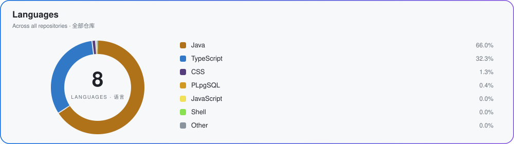

  <picture>
    <source media="(prefers-color-scheme: dark)" srcset="assets/fdf16acf0b/hero-dark.svg">
    
  </picture>

  <a href="#english">English</a> · <a href="#简体中文">简体中文</a>

---

## Snapshot · 数据一览

  <picture>
    <source media="(prefers-color-scheme: dark)" srcset="assets/fdf16acf0b/stats-dark.svg">
    
  </picture>

## Activity · 活动

  <picture>
    <source media="(prefers-color-scheme: dark)" srcset="assets/fdf16acf0b/commit-heatmap-dark.svg">
    
  </picture>

## Languages · 语言

  <picture>
    <source media="(prefers-color-scheme: dark)" srcset="assets/fdf16acf0b/languages-dark.svg">
    
  </picture>

## Contributors · 贡献者

  <picture>
    <source media="(prefers-color-scheme: dark)" srcset="assets/fdf16acf0b/contributors-dark.svg">
    
  </picture>

---

## English

### About Us

TOLIM Technologies is a software engineering company building secure, reliable engineering infrastructure for modern software systems.

### Our Vision

Make security-critical engineering safe by default: stable APIs, explicit boundaries and fail-closed behavior.

### Our Slogan

Secure by design. Delivered with care.

### Explore

- [Repositories](https://github.com/orgs/tolimsuite/repositories)
- [Packages](https://github.com/orgs/tolimsuite/packages)
- [Website](https://tolim.cn)

### Join Us

TOLIM welcomes engineers, researchers and open-source contributors. Browse the repositories and open an issue in the project that fits.

---

## 简体中文

### 关于我们

TOLIM Technologies 是一家软件工程公司，为现代软件系统构建安全、可靠的工程基础设施。

### 我们的愿景

让安全关键型工程默认安全：稳定的 API、清晰的边界与失败关闭的行为。

### 我们的口号

安全设计，可靠交付。

### 探索

- [仓库](https://github.com/orgs/tolimsuite/repositories)
- [包](https://github.com/orgs/tolimsuite/packages)
- [官网](https://tolim.cn)

### 加入我们

TOLIM 欢迎工程师、研究者和开源贡献者。浏览仓库，在合适的项目中提交 issue。

---

  © TOLIM Technologies Pte. Ltd. · Apache-2.0

